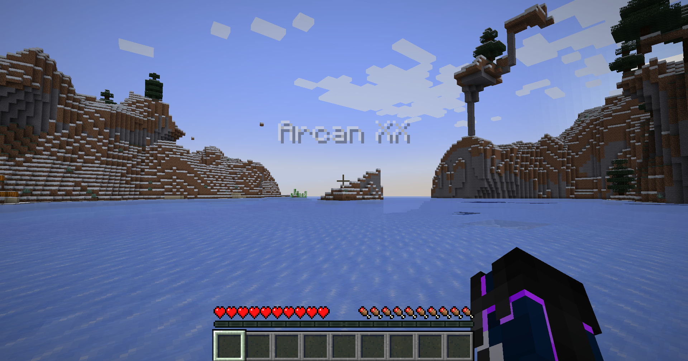

# World Souls

A little world name generator by angychikngames.

Tired of starting a new Minecraft world and getting attached to a place called *My World (1)*? Me too.

World Souls takes inspiration from ConcernedApe's wonderfully odd name generators and the ancient, living worlds of World of Warcraft. A handful of syllables come together, and suddenly, your world has a name.

World Souls adds a dice button beside the World Name field on the Create World screen. Keep rolling until a name feels right, or use one as a starting point and make it your own.

Your world's name also appears briefly when you load in and stays visible in the pause menu. Writing lore with a book and quill but forgot what eldritch abomination the generator came up with? Press Escape. Saves you quitting out just to check.

Names are assembled from randomized syllables, blending soft vowels with older, stranger sounds. They range from 3 to 16 characters long, with over 181 million possible names.

And, in accordance with Sturgeon's Law, 90% of everything is crap. Some rolls will be ancient and mysterious. Some will be beautiful accidents. Some will be Bellolooszy.

Hopefully, one of them suits your world.

Available for Minecraft Java Edition 1.12.2, 1.16.5, and 1.20.1 on Forge, and 26.3 on NeoForge.

## Versions

| Minecraft Java Edition | Loader | Branch |
| --- | --- | --- |
| 1.12.2 | Forge | `forge-1.12.2` |
| 1.16.5 | Forge | `forge-1.16.5` |
| 1.20.1 | Forge | `forge-1.20.1` |
| 26.3 | NeoForge | `neoforge-26.3` |

## Installation

Put the JAR for your Minecraft version and loader in your instance's `mods` folder. World Souls runs on the client. The world-name displays use the local saved name, including when hosting a LAN world.

## Building

Switch to the branch for the Minecraft version you want to work on. Each version branch has its Gradle wrapper, build files, and `src/` at the repository root. `main` holds the project overview and shared documentation. Java requirements and build commands are in the README on each version branch.

## Issues and contributions

Bug reports, ideas, ports, and pull requests are welcome. See [Contributing](CONTRIBUTING.md) if you would like to help.

## Credits and license

Mod, icon, and dice artwork by angychikngames.

Inspired by ConcernedApe's name generators and the worlds of World of Warcraft. World Souls is an unofficial fan project.

Code and artwork are licensed under [CC BY-NC-SA 4.0](LICENSE). Name-filter fingerprints use data from [David Sojevic's Profanity List](https://github.com/dsojevic/profanity-list); its MIT notice is in [THIRD-PARTY-NOTICES](THIRD-PARTY-NOTICES).

